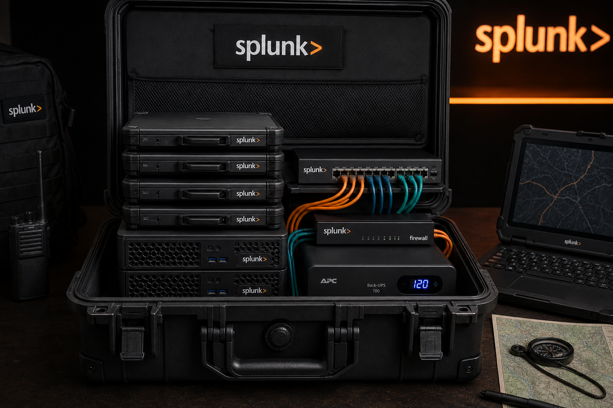
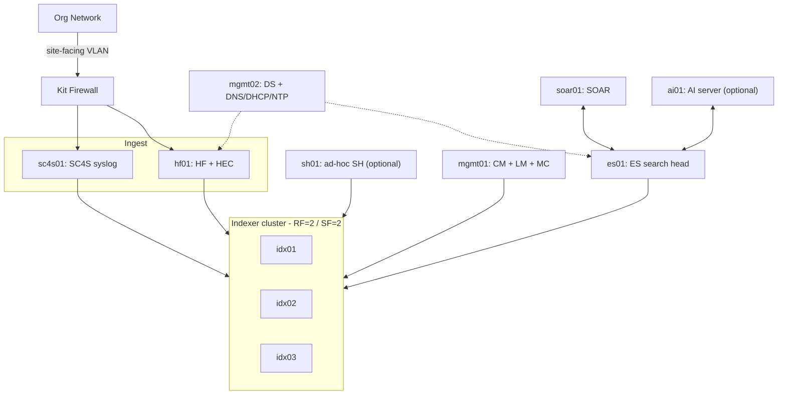

# Splunk Flyaway Kit

A portable, rapidly deployable Splunk Enterprise environment built from ruggedized
laptops and small-form-factor desktop PCs running Linux. The kit is designed to be
carried to a site, powered on, networked, and ingesting data within a short, repeatable
window - whether the site has internet access or is fully air-gapped.

This repository is **documentation only**. It is the design, bill of materials, network
plan, build standard, deployment runbooks, and operational procedures for assembling and
operating the kit. It contains no automation or OS images (see
[Out of scope](#out-of-scope)), but the runbooks carry copy-paste configuration snippets
so they can be acted on directly.

## Missions

The kit is general-purpose and sized to cover three mission profiles (see
[docs/12-mission-profiles.md](docs/12-mission-profiles.md)):

- **Incident response / DFIR** - stand up a collection and analysis platform at a
  customer or field site, with evidence handling and chain-of-custody discipline.
- **Tactical / disconnected operations** - monitoring in environments with little or no
  connectivity (field, disaster response, exercise).
- **Demo / training / workshop** - a self-contained teaching or proof-of-value
  environment.

## Tiers

The kit comes in three sizes. Pick the smallest tier that meets the daily ingest and
retention requirement.

| Tier | Kit Hosts | Daily ingest | Indexing | Search | Use when |
| --- | --- | --- | --- | --- | --- |
| **Small** | ~4-6 | < 50 GB/day | 1 standalone indexer OR 2-node index cluster | Single ES search head | One-off IR, small site, demo |
| **Medium** | ~7-10 | 50-300 GB/day | 2-node indexer cluster (RF=2, SF=2) | ES search head + optional ad-hoc SH | Most field deployments |
| **Large** | 12+ | 300 GB+/day | 4-6 node indexer cluster | 3-member ES search head cluster + deployer | High-volume or long-retention missions |

All tiers run the same software baseline (Splunk Enterprise 10.6, SOAR On-premises 8.7)
and differ only in node count and role distribution. See
[docs/01-architecture.md](docs/01-architecture.md).

## Connectivity modes

Every procedure supports both:

- **Air-gapped** - all installers, OS packages, apps, add-ons, licenses, and checksums
  are carried on the kit's offline media. No internet required. See
  [docs/06-offline-repo.md](docs/06-offline-repo.md).
- **Connected / intermittent** - optional online updates and optional remote data
  replication over a site-to-site VPN or a self-hosted Headscale mesh. See
  [docs/14-remote-replication-vpn.md](docs/14-remote-replication-vpn.md).

## Architecture at a glance

The diagram below is an illustrative example of a **Medium-tier** deployment (~7-10 hosts,
50-300 GB/day) - the default field setup: a 3-peer indexer cluster (RF=2/SF=2), a dedicated
ES search head, split management hosts, and optional SOAR and AI server. Desktops index
(CPU + NVMe); laptops search, manage, and ingest. Node count is the main thing that changes
between tiers - see [docs/01-architecture.md](docs/01-architecture.md) for the Small and
Large topologies and the sizing math.

## Document map

| Doc | Contents |
|-----|----------|
| [docs/01-architecture.md](docs/01-architecture.md) | Roles, per-tier topologies, sizing math, optional AI server |
| [docs/02-hardware-bom.md](docs/02-hardware-bom.md) | Bill of materials per tier: compute, storage, Cisco/Meraki network gear, firewall, UPS, cases; power and weight budget |
| [docs/03-network-design.md](docs/03-network-design.md) | Switch tiers (1 GbE min / 10 GbE recommended), VLANs, IP plan, ports matrix, DNS/DHCP/NTP, firewall policy |
| [docs/04-os-baseline.md](docs/04-os-baseline.md) | Linux build standard; SOAR OS constraints |
| [docs/05-splunk-deployment.md](docs/05-splunk-deployment.md) | Per-tier install order and role configs; management colocation; ES and SOAR integration |
| [docs/06-offline-repo.md](docs/06-offline-repo.md) | Building and refreshing offline media; connected-mode policy |
| [docs/07-containerization.md](docs/07-containerization.md) | Optional Docker/Podman deployment; role consolidation; management tools; SOAR exception |
| [docs/08-runbook-deploy.md](docs/08-runbook-deploy.md) | Rapid on-site deployment checklist with a time target |
| [docs/09-runbook-operations.md](docs/09-runbook-operations.md) | Monitoring, health checks, degraded-mode operation |
| [docs/10-runbook-teardown.md](docs/10-runbook-teardown.md) | Data export, evidence handoff, secure wipe, repack |
| [docs/11-security.md](docs/11-security.md) | Hardening, TLS, VPN keys, credentials, data classification |
| [docs/12-mission-profiles.md](docs/12-mission-profiles.md) | IR, tactical, and demo/training profiles |
| [docs/13-site-integration.md](docs/13-site-integration.md) | Connecting to the org network; site questionnaire; ingestion paths and required firewall rules |
| [docs/14-remote-replication-vpn.md](docs/14-remote-replication-vpn.md) | Site-to-site IPsec, Headscale, data mirroring options |
| [docs/15-flyaway-kit-app-concept.md](docs/15-flyaway-kit-app-concept.md) | Conceptual data-source onboarding/checklist app (not built) |
| [docs/appendix-checklists.md](docs/appendix-checklists.md) | Printable pre-departure, arrival, and teardown checklists |

## Software baseline

| Component | Version | Notes |
| --- | --- | --- |
| Splunk Enterprise | 10.6 | Pin the exact build in the kit manifest |
| Splunk Universal Forwarder | 10.x (match Enterprise) | SOAR 8.7 bundles UF 10.4.1 |
| Splunk Enterprise Security* | Current supported with 10.6 | Dedicated search head.  Agentic SOC agents do not work air-gapped without the Splunk AI tier. |
| Splunk SOAR (On-premises) | 8.7 | RHEL/Oracle/Amazon Linux only; not Ubuntu; not containerized |
| OS - Splunk roles | Rocky Linux 9 / RHEL 9 (primary), Ubuntu 24.04 LTS (alt) | See [docs/04-os-baseline.md](docs/04-os-baseline.md) |
| OS - SOAR role | RHEL 9.7+ / Rocky 9.7+ / Oracle Linux 9 | SOAR does not support Ubuntu |

> Information in this document is current as of November, 2026.
> Re-verify against [help.splunk.com](https://help.splunk.com) and pin exact builds in the
> manifest before each kit build. Cisco and Meraki model numbers are references.

## Out of scope

- Configuration automation (Ansible, shell). The docs mark where it would slot in.
- Golden images and unattended installers (kickstart / autoinstall).
- Building the Flyaway Kit onboarding app ([docs/15-flyaway-kit-app-concept.md](docs/15-flyaway-kit-app-concept.md) is a concept only).
