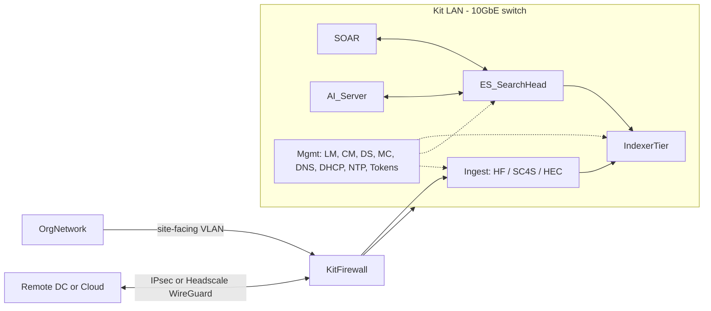
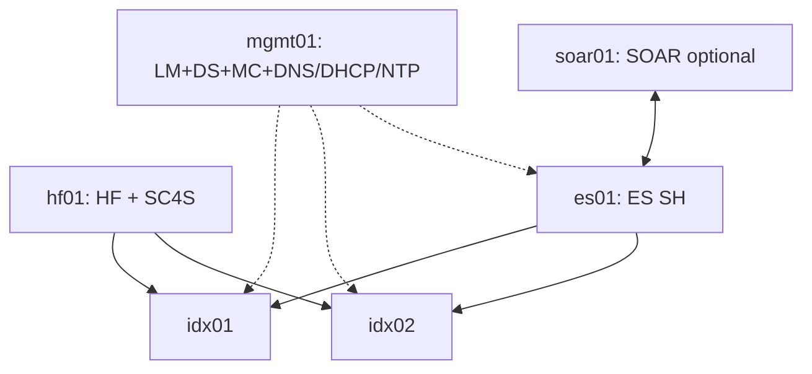
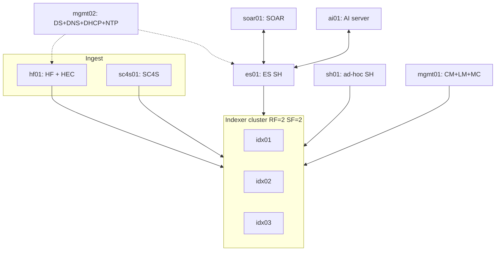
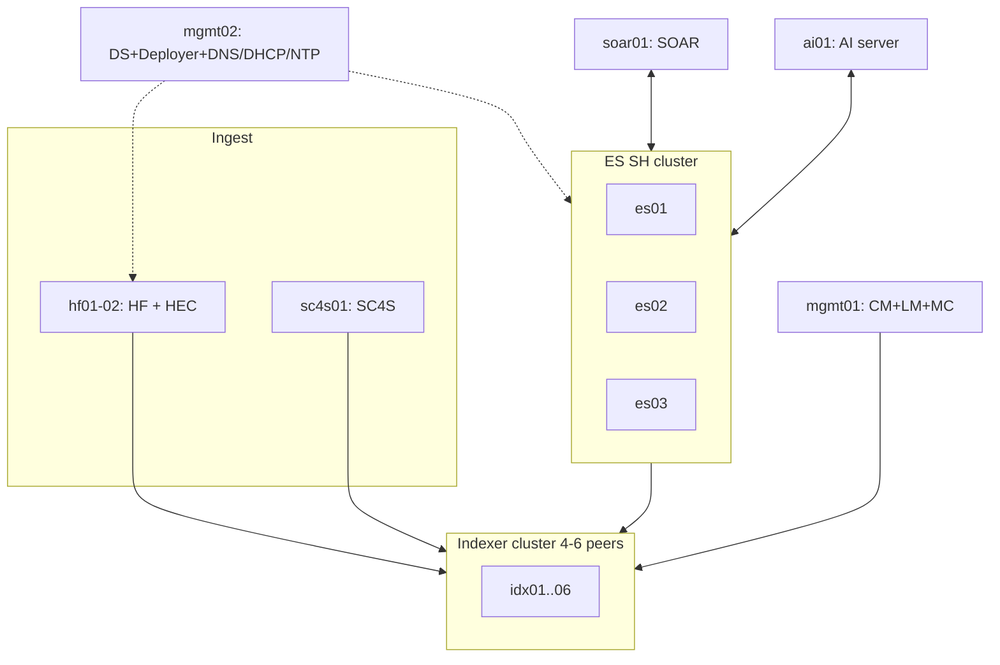

# 01 - Architecture

This document defines the Splunk roles in the kit, how they map to physical hardware
(laptops and desktops), the per-tier topologies, and the sizing math used to choose a
tier.

## Design principles

- **Smallest thing that works.** Pick the lowest tier that meets daily ingest and
  retention. Every added node is more weight, power, setup time, and failure surface.
- **Desktops index, laptops manage and search.** Desktops carry the CPU and NVMe needed
  for indexing and replication. Laptops run search, management, and ingest roles - they
  are portable and each has a built-in UPS (its battery) that rides out power blips.
- **Repeatable role assignment.** The same hostname/role map is used every deployment so
  the runbooks, configs, and the IP plan never change between missions.
- **Honest colocation.** Where kit constraints push roles onto one host, the deviation
  from Splunk's reference guidance is called out explicitly (see
  [Management role colocation](#management-role-colocation)).

## Roles

All roles sit on the kit LAN (see [03-network-design.md](03-network-design.md)) and are
networked together through the kit switch and firewall.

| Role | Purpose | Typical host |
|------|---------|--------------|
| **ES search head** | Splunk Enterprise Security - the analyst UI, correlation searches, notables, data models | Laptop (dedicated) |
| **Ad-hoc search head** | Non-ES searching, hunting, dashboards (optional) | Laptop |
| **Indexer** | Parse, index, store, and search data | Desktop (NVMe) |
| **Cluster manager (CM)** | Coordinates the indexer cluster (Medium/Large only) | Laptop / mgmt host |
| **License manager (LM)** | Central license repository | Mgmt host |
| **Deployment server (DS)** | Pushes apps/TAs to forwarders and other clients | Mgmt host |
| **Monitoring console (MC)** | Health of the whole deployment | Mgmt host |
| **SH cluster deployer** | Pushes config to ES SH cluster members (Large only) | Mgmt host |
| **HEC / token management** | HTTP Event Collector endpoint and token admin | Ingest/HF host |
| **Heavy forwarder (HF)** | Modular/API inputs, routing, the dual-homed site touchpoint | Laptop/desktop |
| **SC4S** | Splunk Connect for Syslog (containerized syslog ingest) | Ingest host |
| **SOAR** | Splunk SOAR On-premises - automation/playbooks | Desktop (RHEL-family) |
| **AI server** (optional) | AI harness (local or subscription) wired to the Splunk MCP server - see [AI server](#ai-server-optional) | Simple PC or laptop |
| **Kit services** | DNS, DHCP (kit LAN), NTP (chrony) | Mgmt host |

### Management role colocation

Splunk's reference guidance on combining management components
([Components that help to manage your deployment](https://help.splunk.com/en/splunk-enterprise/administer/distributed-deployment-manual/10.6/overview-of-splunk-enterprise-distributed-deployments/components-that-help-to-manage-your-deployment))
gives this colocation matrix:

| Component | LM | MC | DS | CM | Deployer | Indexer | Search head |
|-----------|----|----|----|----|----------|---------|-------------|
| License manager | - | yes | yes | yes | yes | yes | yes |
| Monitoring console | yes | - | yes | yes | yes | **no** | yes |
| Deployment server | yes | yes | - | **no** | yes | yes | yes |
| Cluster manager | yes | yes | **no** | - | yes | **no** | **no** |
| SH cluster deployer | yes | yes | yes | yes | - | **no** | **no** |

The hard rules that affect this kit:

- **Cluster manager must not share a host with the deployment server, an indexer, or a
  search head.** Both CM and DS have strict resource limits.
- **Monitoring console must not share a host with an indexer.** With SmartStore it needs a
  dedicated search head; the kit does not use SmartStore.

Consequences per tier:

- **Small** has no indexer cluster, so there is no CM. LM + DS + MC + DNS/DHCP/NTP can
  share one management laptop because the client count and search load are tiny (MC on a
  DS is supported for < 50 clients).
- **Medium/Large** have a cluster, so the CM must be separate from the DS. The management
  roles split across two hosts (see topologies below).

> In Small and in low-load Medium kits we co-locate more management roles on
> one box than the reference architecture prefers. The ceiling is host CPU/RAM and the
> < 50 deployment-client limit for MC-on-DS. Upgrade path: promote to the Large
> two-management-host split, or add a dedicated MC laptop, if the MC or DS shows load in
> the monitoring console.

Colocation can also be done with **containers** - each role in its own Docker/Podman
container on a shared host - which is often the fastest way to consolidate the management
roles. The same resource ceilings apply at the host level. See
[07-containerization.md](07-containerization.md).

## Reference topology (all tiers)



## Small tier

4-6 hosts, < 50 GB/day, single analyst or small team, short retention.

| Host | Role(s) | Hardware |
|------|---------|----------|
| mgmt01 | LM + DS + MC + DNS/DHCP/NTP + HEC token admin | Laptop |
| es01 | ES search head (also runs ad-hoc search) | Laptop |
| idx01 | Standalone indexer | Desktop |
| idx02 | Standalone indexer (optional, for capacity/redundancy) | Desktop |
| hf01 | Heavy forwarder + SC4S (site touchpoint) | Laptop/desktop |
| soar01 | SOAR (optional) | Desktop (RHEL-family) |



Notes:
- Indexers are **standalone** (no cluster). Two indexers means no replication - if one
  dies, its data is unavailable until restored. If you need survivability at this size,
  step up to Medium.
- `es01` forwards its own internal logs to the indexers and does not index data locally.

## Medium tier

7-10 hosts, 50-300 GB/day. This is the default field deployment.

| Host | Role(s) | Hardware |
|------|---------|----------|
| mgmt01 | CM + LM + MC | Laptop |
| mgmt02 | DS + DNS + DHCP + NTP | Laptop |
| es01 | ES search head | Laptop |
| sh01 | Ad-hoc search head (optional) | Laptop |
| idx01-03 | Indexer cluster peers (RF=2, SF=2) | Desktop x3 |
| hf01 | Heavy forwarder + HEC | Laptop/desktop |
| sc4s01 | SC4S syslog ingest | Laptop/desktop |
| soar01 | SOAR | Desktop (RHEL-family) |
| ai01 | AI server (optional) | Simple PC/laptop |




> Notes:
>
> - RF=2/SF=2 means each bucket has 2 copies and the cluster can lose **one** indexer with
> no data loss and full searchability. See [09-runbook-operations.md](09-runbook-operations.md)
> for degraded-mode behavior.
>
> - CM is isolated from DS per the colocation rules above.

## Large tier

12+ hosts, 300 GB+/day, longer retention, multiple analysts.

| Host | Role(s) | Hardware |
|------|---------|----------|
| mgmt01 | CM + LM + MC | Laptop/desktop |
| mgmt02 | DS + ES SH cluster deployer + DNS + DHCP + NTP | Laptop/desktop |
| es01-03 | ES search head cluster members | Laptop x3 |
| idx01-06 | Indexer cluster peers (RF=2/3, SF=2) | Desktop x4-6 |
| hf01-02 | Heavy forwarders + HEC | Laptop/desktop x2 |
| sc4s01 | SC4S syslog ingest | Laptop/desktop |
| soar01 | SOAR (cluster-capable) | Desktop (RHEL-family) |
| ai01 | AI server (optional) | Simple PC/laptop |




> Notes:
>
> - The deployer (for the ES SH cluster) and the DS can colocate; neither colocates with
> the CM.
>
> - The ES SH cluster needs an odd number of members (3 shown) for its captain election.

## Sizing math

Use these to pick a tier and count indexers. They are planning estimates - validate in
the monitoring console once data flows.

**Indexer count (indexing workload)**
A reference indexer handles roughly 100-300 GB/day depending on parsing cost, search
concurrency, and hardware. For kit desktops (fast NVMe, 8+ physical cores), plan on
**~100 GB/day/indexer** sustained with headroom for search:

```
indexers = ceil(daily_ingest_GB / 100)        # standalone
indexers = ceil((daily_ingest_GB / 100) + 1)  # clustered, +1 so RF/SF survive one loss
```

**Storage per indexer**

```
raw_per_day          = daily_ingest_GB
indexed_size_per_day = daily_ingest_GB * 0.5   # rawdata ~15% + tsidx ~35% ~= ~50% of raw (rule of thumb; varies by data)
cluster_multiplier   = RF (e.g. 2)             # clustered only; standalone = 1
total_storage_GB     = indexed_size_per_day * retention_days * cluster_multiplier / indexer_count
```

Example:
200 GB/day, 30-day retention, 3 indexers, RF=2:
`200 * 0.5 * 30 * 2 / 3 = 2000 GB/indexer` -> provision ~2.5 TB NVMe/indexer.

**RAM / CPU**
Follow Splunk reference hardware: a mid-range indexer is ~12 physical cores / 12 GB RAM
minimum; search heads benefit from more RAM. ES search heads and SOAR want 64 GB+.
See [02-hardware-bom.md](02-hardware-bom.md) for the concrete per-tier specs.

## AI Server (optional)

The AI server is an **optional** add-on, reserved as `ai01` in every topology and in the
network/IP plan ([03](03-network-design.md)). It is not required to operate the kit; add
it when the mission wants AI-assisted analysis or SPL help on top of Splunk.

It is deliberately modest hardware - **a simple PC or laptop**, not a GPU box - because the
heavy lifting is done either by a local lightweight harness or by a remote
subscription/private service. The AI server's job is to run an **AI harness** and connect
it to Splunk through the **[Splunk MCP server](https://www.splunk.com/)** (Model Context
Protocol), so the agent can query Splunk and reason over results as well as establish connections to cloud-based or self-hosted AI models.

AI harnesses can be installed on this host for remote access by cyber security analysts.

#### Self-hosted AI Models

For locally and remotely hosted AI models, high-end Nvidia or AMD GPUs maybe used to host LLMs.  Linux OS distributions and LLM inference engines such as vllm or SGlang are recommended for performance and parallel inferencing jobs for air-gapped environments or organizations that do not allow remote AI services such as OpenAI, Anthropic, Google, xAI, etc.

This can also be hosted in a remote co-location, data center or office for faster and less expensive deployment purposes; access via VPN or TLS/SSL.

Depending upon the need for self-hosted AI, the AI hardware may be included as an additional asset.  Current open-weight LLMs can run on PCIe AI GPU cards such as the Nvidia RTX Pro 6000 - 96GB VRAM or AMD Instinct MI350P - 144GB VRAM.   Desktop-grade AMD or Intel CPUs and at least 64GB of DDR5 RAM and 2TB+ of storage will suffice.

Higher end server-grade CPUs and GPUs may be used, but carries the risk of weight and cost.

**<u>IMPORTANT</u>**: As of November 2026, Splunk AI Assistant and Enterprise Security AI Agent functions cannot connect or use self-hosted AI services.

There are no recommended open weight models in this document.  Individual, self-testing is required.

#### Self-hosted Splunk AI

Splunk provides [Splunk AI Operator](https://github.com/splunk/splunk-ai-operator) and [Splunk AI Tier](https://github.com/splunk/splunk-ai-operator/blob/release/v1.0/docs/ai-tier-docs/k0s-quick-reference.md) to host Splunk AI infrastructure that allows Splunk AI Assistant (SAIA) and Splunk Enterprise Security Agentic SOC features to run without Splunk AI Cloud service.

Due to the hardware requirements, it is recommended to host this remotely, accessible with a VPN connection or TLS SSL connection from the locally deployed Splunk hosts.

**<u>IMPORTANT:</u>** Splunk AI capabilities are limited to Splunk AI Assistant and Enterprise Security AI Agent functions.  One cannot have general conversations or ask questions or make requests outside of the strict guardrails in place.

For AI chat use cases outside of Splunk AI, use self-hosted AI service and/or cloud-based AI services.

#### Cloud-based AI Service Integration

Leveraging AI subscriptions such as OpenAI, Anthropic, Google, xAI, etc. can be used with the respective AI harnesses with the [Splunk MCP server](https://help.splunk.com/en/splunk-cloud-platform/mcp-server-for-splunk-platform/2.1/about-splunk-mcp-server/about-mcp-server-for-splunk-platform) connection and/or [SplunkCTL](https://github.com/splunk/splunkctl) to query Splunk indexes, generate reports, alerts, dashboards, etc.

### Harness options

| Option | What runs on `ai01` | Connectivity | Data posture |
|--------|---------------------|--------------|--------------|
| **Local harness (e.g. Pi)** | A self-contained/local AI harness such as Pi running on the PC/laptop | Works air-gapped if the model is local | Mission data stays on the kit |
| **Subscription harness** | A vendor agent client - Anthropic Claude (e.g. Claude Code / Agent SDK) or OpenAI Codex - pointed at the vendor API | Connected mode only (needs egress to the vendor) | Mission data leaves the kit; see [11-security.md](11-security.md) |
| **Team's private AI service** | The security team's own harness (e.g. a Pi Agent) pointed at their own private model endpoint | Per the team's network (VPN/[14](14-remote-replication-vpn.md)) | Governed by the team's own service |

In all three cases the harness is configured for the **Splunk MCP server** so it can
inspect indexes, run searches, and explain/optimize SPL against the kit's data. If the
security team owns a private AI service, it can be used the same way - point their harness
(such as a Pi Agent) at their private endpoint instead of a public vendor.

### Placement and integration

- `ai01` sits on the kit data VLAN ([03](03-network-design.md#ip-and-hostname-plan)) and
  reaches the search head / indexers over Splunk's REST/MCP interface (8089).
- The MCP server runs either on `ai01` or on a search head; the harness connects to it.
- Analysts interact with the harness directly (its own UI/CLI) or via SOAR actions.
- Install and configuration steps live in
  [05-splunk-deployment.md](05-splunk-deployment.md#ai-server-optional).

### Connectivity and data-sensitivity caution

The choice of harness is a **connectivity and data-classification decision**
([11-security.md](11-security.md#data-classification)):

- A **local** harness (Pi with a local model) is the only option that keeps mission data
  on the kit and works **air-gapped**.
- A **subscription** harness (Claude, Codex) requires egress to the vendor API - it is
  **connected mode only**, and sending mission data off-kit must be allowed by the
  mission's data-handling rules. Route any egress through the firewall with an explicit,
  logged allow rule ([06](06-offline-repo.md#connected-mode-policy)).
- A **private** team service keeps data within the team's control but still crosses the
  link to their endpoint - treat that link per [14](14-remote-replication-vpn.md) and
  [11](11-security.md).

> Hardware specs for `ai01` depend on the harness. A subscription or private
> remote service needs only a light client (any modern PC/laptop). A *local* model harness
> may need more RAM/VRAM than a plain laptop provides - size it to the chosen local model
> before committing it to the BOM ([02](02-hardware-bom.md)).
