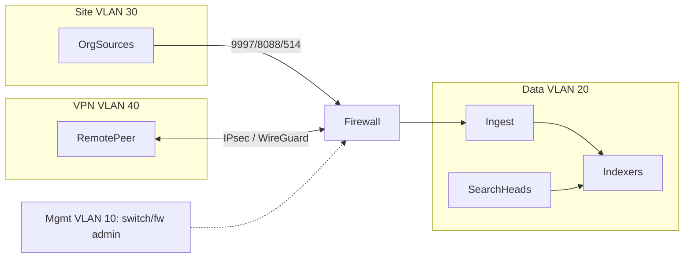

# 03 - Network Design

The kit ships with its own self-contained network so it behaves identically every
deployment regardless of the site. This document defines the switch choice, bandwidth
policy, VLAN layout, the fixed IP/hostname plan, the Splunk ports matrix, the kit's
DNS/DHCP/NTP services, and the firewall policy.

## Bandwidth policy

- **1 GbE minimum** on every host.
- **10 GbE recommended** for indexers, search heads, and the switch backbone/uplink.
- The traffic that most needs 10 GbE: indexer-to-indexer **replication (9887)** in a
  cluster, bulk **forwarding (9997)** during a burst/backfill, and distributed search
  fan-out from the ES search head.

See [02-hardware-bom.md](02-hardware-bom.md#switches-reference) for the switch SKUs per
tier (Catalyst for air-gap, Meraki for connected-only).

## VLAN layout

A small set of VLANs keeps management, data, site traffic, and VPN transit separated.
For the Small tier a single flat VLAN is acceptable; Medium/Large should segment.

| VLAN | Name | Purpose | Example subnet |
|------|------|---------|----------------|
| 10 | mgmt | Out-of-band/host mgmt, IPMI, switch/firewall mgmt | 10.73.10.0/24 |
| 20 | data | Splunk data plane: forwarding, replication, search | 10.73.20.0/24 |
| 30 | site | Site-facing ingest interface(s) toward the org network | 10.73.30.0/24 |
| 40 | vpn | VPN transit to remote DC/cloud / Headscale | 10.73.40.0/24 |
| 50 | wifi | Optional operator/analyst Wi-Fi access (opt-in, off by default) | 10.73.50.0/24 |

Notes:
- The data VLAN (20) carries the bulk of traffic - put the 10 GbE here.
- The site VLAN (30) is the only one that touches the organization's network and only via
  the firewall or a dual-homed heavy forwarder (see [13-site-integration.md](13-site-integration.md)).
- Color-code patch cables by VLAN and label both ends to the hostnames below.

## IP and hostname plan

Fixed addressing on the data VLAN so configs, DNS, and runbooks never change between
missions. The example uses `10.73.20.0/24` with domain `kit.local`.

> The `10.73.x.x` range is chosen to avoid the very common `10.0.x`, `192.168.0/1.x`, and
> `172.16.x` ranges that organizations use, reducing the chance of a clash when the kit
> joins a site. If it still clashes, re-address the data VLAN once and update DNS + the
> few config files that pin IPs (CM `server.conf`, `outputs.conf`, LM URI).

| Hostname | Role | Data VLAN IP | Present in |
|----------|------|--------------|-----------|
| mgmt01.kit.local | CM+LM+MC (S: +DS+DNS/DHCP/NTP) | 10.73.20.11 | all |
| mgmt02.kit.local | DS (+Deployer, DNS/DHCP/NTP) | 10.73.20.12 | M/L |
| es01.kit.local | ES search head (SHC member) | 10.73.20.21 | all |
| es02.kit.local | ES SHC member | 10.73.20.22 | L |
| es03.kit.local | ES SHC member | 10.73.20.23 | L |
| sh01.kit.local | Ad-hoc search head | 10.73.20.29 | M (opt) |
| idx01.kit.local | Indexer | 10.73.20.31 | all |
| idx02.kit.local | Indexer | 10.73.20.32 | S(opt)/M/L |
| idx03.kit.local | Indexer | 10.73.20.33 | M/L |
| idx04-06.kit.local | Indexer | 10.73.20.34-36 | L |
| hf01.kit.local | Heavy forwarder + HEC | 10.73.20.41 | all |
| hf02.kit.local | Heavy forwarder + HEC | 10.73.20.42 | L |
| sc4s01.kit.local | SC4S syslog | 10.73.20.45 | M/L (S: on hf01) |
| soar01.kit.local | SOAR | 10.73.20.51 | S(opt)/M/L |
| ai01.kit.local | AI server (optional) | 10.73.20.61 | opt (any tier) |
| sw01 / fw01 | Switch / firewall mgmt | 10.73.10.2 / 10.73.10.1 | mgmt VLAN |
| ap01.kit.local | Wi-Fi access point (optional) | 10.73.10.3 | opt (mgmt VLAN) |

Reserve `10.73.20.100-199` in DHCP for transient clients (analyst workstations, a
site-provided forwarder under test). Everything in the table is static.

## Splunk ports matrix

Splunk default ports (all configurable; these are the defaults the runbooks assume).
Open these **within the kit LAN**; the subset that must be opened on the org firewall for
ingestion is in [13-site-integration.md](13-site-integration.md).

| Port | Proto | Service | Direction / who | 
|------|-------|---------|-----------------|
| 8000 | TCP | Splunk Web (HTTPS) | Analysts -> SH/MC |
| 8089 | TCP | splunkd management/REST | All Splunk <-> all Splunk (CM, LM, DS, deployer, MC, peers) |
| 9997 | TCP | Forwarder receiving | Forwarders/HF -> indexers |
| 9887 | TCP | Indexer cluster replication | Indexer <-> indexer (cluster only) |
| 8088 | TCP | HTTP Event Collector (HEC) | Sources -> HF/indexers |
| 8065 | TCP | App server (internal) | Local on SH |
| 8191 | TCP | KV store (mongod) | SH / SHC members |
| 8181 | TCP | SHC replication port (example; admin-chosen) | ES SHC members (L) |
| 514 | UDP/TCP | Syslog in (to SC4S) | Devices -> SC4S |
| 6514 | TCP | Syslog over TLS (to SC4S) | Devices -> SC4S |
| 123 | UDP | NTP | All hosts -> mgmt (chrony) |
| 53 | UDP/TCP | DNS | All hosts -> mgmt |
| 67/68 | UDP | DHCP (kit LAN only) | Transient clients -> mgmt |

SOAR ports:

| Port | Proto | Service |
|------|-------|---------|
| 443 | TCP | SOAR web UI / REST |
| 5432 | TCP | PostgreSQL 15 (SOAR internal; local unless clustered) |
| 9200/9300 | TCP | Elasticsearch (SOAR internal) |
| GlusterFS ports | TCP | SOAR cluster file shares (clustered SOAR only) |

## Kit services: DNS, DHCP, NTP

Hosted on the management node (`mgmt01` in Small; `mgmt02` in Medium/Large).

- **DNS** - authoritative for `kit.local` with forward and reverse zones matching the IP
  plan. In air-gapped mode it is the only resolver; in connected mode it forwards unknown
  queries upstream (or to the firewall). Every host uses `kit.local` names, never raw IPs,
  so re-addressing touches one zone file.
- **DHCP** - serves only the reserved transient range on the data VLAN; all infrastructure
  hosts are static. Keeps a rogue DHCP server off the org network - the kit's DHCP must
  **not** be bridged onto the site VLAN.
- **NTP (chrony)** - the kit's authoritative time source. Correct time is critical:
  Splunk indexes events by timestamp, cluster/SHC elections and TLS cert validation all
  depend on agreed time, and skew corrupts correlation. When connected, chrony disciplines
  to an upstream/GPS source; when air-gapped it free-runs from `mgmt` (optionally a small
  GPS/PPS dongle for drift control on long missions).

> Note:
>
> Air-gapped chrony free-running from one host drifts over long deployments.
> Ceiling: clock drift on multi-week missions. Upgrade path: add a GPS/PPS time source on
> the mgmt node.

## Firewall policy

The firewall (Cisco Secure Firewall 1210 default, or similar locally-managed firewall;
Meraki MX or similar cloud-managed firewall is connected-only) sits between
the kit LAN and both the site VLAN and any VPN transit.

Default stance - **deny all, allow by exception**:

- **Kit LAN internal** - permit the ports matrix above between kit hosts (ideally
  switch-enforced within the data VLAN; the firewall governs inter-VLAN).
- **Site VLAN (ingestion)** - permit only the specific ingest ports inbound from the
  org's sources to the kit's HF/HEC/SC4S (9997, 8088, 514/6514), and only the specific
  egress the kit needs (e.g. UF pull of apps). Enumerated in
  [13-site-integration.md](13-site-integration.md).
- **VPN transit** - permit only IPsec (IKE/UDP 500, NAT-T/UDP 4500, ESP) or Headscale
  WireGuard (UDP 41641 + the Headscale control port) to the specific remote peer. See
  [14-remote-replication-vpn.md](14-remote-replication-vpn.md).
- **Wi-Fi VLAN (optional)** - if Wi-Fi is enabled, permit wireless clients to reach only
  Splunk Web (8000) on the search head/MC; deny the rest of the data plane. See
  [Wi-Fi access](#wi-fi-access-optional).
- **Management** - restrict switch/firewall admin to the mgmt VLAN only.
- Log denies; export firewall logs into Splunk as a data source.

## Wi-Fi access (optional)

The kit is wired-first. Wi-Fi is **opt-in** and should stay **off for air-gapped and
high-sensitivity missions** - a wireless radio is extra attack surface and can trip a
site's wireless IDS. Enable it only when operators genuinely need cable-free access to
Splunk Web in the field, and treat it as untrusted transit, not part of the trusted data
plane.

When Wi-Fi is used:

- **Dedicated AP on its own VLAN.** Use a dedicated access point (Meraki MR-series or a
  Catalyst 9100-series AP, or similar) on the `wifi` VLAN (50). For air-gapped missions the
  AP must be locally manageable - cloud-managed Meraki APs need egress, so use an
  embedded/Catalyst AP in air-gap, the same split as the switches in
  [02-hardware-bom.md](02-hardware-bom.md#switches-reference).
- **Scope it to Splunk Web only.** Firewall the Wi-Fi VLAN so wireless clients reach only
  port 8000 on the search head/MC - never the forwarding (9997), replication (9887), HEC,
  or management (8089) ports. Analysts browse; they do not join the data plane.
- **WPA3, 802.1X preferred.** Use WPA3-Enterprise (802.1X) backed by the kit's own RADIUS
  where feasible, so each operator has an individual credential that can be revoked. If
  Enterprise auth is impractical in the field, use WPA3-Personal (SAE) with a long, random,
  per-mission passphrase. Never Open, WEP, WPA/TKIP, or WPS.
- **Protected Management Frames (PMF / 802.11w) required**, and enable **client isolation**
  so wireless clients cannot reach each other.
- **Do not bridge Wi-Fi to the site VLAN**, and do not let the kit act as a rogue AP on the
  org's premises - coordinate SSID/channel/power with the site so the kit does not interfere
  with or trip the org's wireless monitoring.
- **Lock down management.** Restrict AP admin to the mgmt VLAN, change default credentials,
  and limit TX power to the immediate work area to reduce signal leakage. A hidden SSID and
  a MAC allowlist are weak defense-in-depth only - not a substitute for WPA3 + 802.1X.
- **Rotate and wipe.** Rotate the passphrase/keys every mission, forward AP
  authentication/association events into Splunk as a data source, and wipe the AP
  configuration at teardown with the rest of the kit
  ([10-runbook-teardown.md](10-runbook-teardown.md#phase-4--secure-wipe),
  [11-security.md](11-security.md)).

> `ponytail:` Wi-Fi is deliberately a thin, scoped add-on (browse-only, one VLAN). The
> ceiling is that it is not meant to carry forwarding/replication traffic. Upgrade path: if
> a mission needs wireless data collection, design a separate hardened WLAN with its own
> risk review rather than widening this one.
