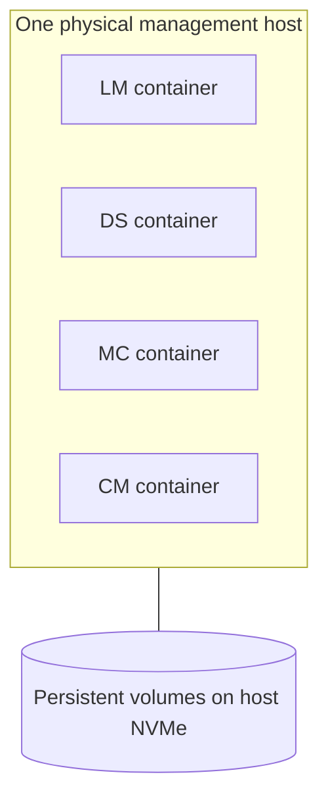

# 07 - Containerization (Docker / Podman)

An optional deployment style. Instead of installing every Splunk role on its own
bare-metal host, you can run roles as containers. This speeds deployment (pull a known
image, start it) and lets several roles share one physical host, cutting the number of
machines the kit has to carry and power. Bare-metal remains fully supported and is still
the right choice for the heaviest indexers; the two styles mix freely.

This complements [05-splunk-deployment.md](05-splunk-deployment.md) (bare-metal install)
and the colocation rules in [01-architecture.md](01-architecture.md#management-role-colocation).

## Why containers in the kit

- **Faster, repeatable deployment** - a role comes up from a pinned image in seconds, with
  no OS-level install step. The image is the unit you validate at base and carry on the
  offline media.
- **Fewer physical hosts** - run multiple role-containers on one machine. For example, the
  management host can run the **license manager, deployment server, monitoring console**,
  and (on a separate host or the same one within resource limits) the **cluster manager**
  as individual containers, consolidating what would otherwise be two or more laptops.
- **Clean teardown** - stop and remove containers, wipe the mapped data volumes.

## What Splunk supports

- **Official images**: Splunk publishes Dockerfiles and the `splunk/splunk` (Enterprise)
  and `splunk/universalforwarder` images via the **docker-splunk** project on GitHub. They
  are Ansible-driven (Splunk's "splunk-ansible") and configured through environment
  variables / a `default.yml`. Use these rather than rolling your own image.
- **Orchestration**: the **Splunk Operator for Kubernetes** deploys single or distributed
  Splunk Enterprise on Kubernetes. For a flyaway kit, full Kubernetes is usually more than
  you need - plain Docker or Podman with a management UI is lighter. The Operator is noted
  for completeness and for sites that already run k8s.
- **Capacity still applies**: a containerized deployment must provide hardware resources
  that **meet or exceed** the same reference capacity as bare metal. Containers package the
  software; they do not reduce the CPU, RAM, or disk I/O a role needs.

> Reference: Splunk's "Containerized computing platforms" and "Splunk Enterprise and
> containerized infrastructures" in the
> [system requirements](https://help.splunk.com/en/splunk-enterprise/get-started/install-and-upgrade/10.6/plan-your-splunk-enterprise-installation/system-requirements-for-use-of-splunk-enterprise-on-premises).

## Which roles can be containerized

| Role | Container? | Notes |
| --- | --- | --- |
| License manager, deployment server, monitoring console | Yes | Lightweight; good candidates to consolidate on one host |
| Cluster manager | Yes | Still bound by its resource limits; keep it off the same container-set as the DS under load ([01](01-architecture.md#management-role-colocation)) |
| Indexer / indexer cluster peer | Yes | Needs a **persistent, block-based** data volume on fast local NVMe; see [storage](#storage-and-persistence). NOT RECOMMENDED OR SUPPORTED for index clusters on the SAME physical host |
| Search head / ES search head / SH cluster | Yes | Map `etc` and KV store to persistent volumes |
| Heavy forwarder, HEC | Yes | Straightforward |
| SC4S | **Yes - already a container** | SC4S is distributed as a container; this is its normal deployment ([05](05-splunk-deployment.md#sc4s-syslog)) |
| **Splunk SOAR** | **No** | Splunk SOAR (On-premises) **cannot be installed inside a Docker or Podman container** - it runs on bare metal (RHEL-family). See [04](04-os-baseline.md#soar-os-constraints-verified-against-splunk-docs) |

Other roles not listed can also run containerized for their intended purpose; the table
above is the common set. The rule of thumb: **anything except SOAR can be a container**,
and you choose per host whether to run it bare-metal or containerized.

## Colocation with containers

Running two roles as two containers on one physical host is a clean way to colocate - each
role is isolated in its own container, but they share the machine. The **same colocation
cautions from [01-architecture.md](01-architecture.md#management-role-colocation) still
apply at the host level**: the cluster manager and deployment server both have strict
resource limits, and stacking them (even in separate containers) on an overloaded host
will hurt both. Set per-container CPU/memory limits and leave headroom for any indexer on
the same host.

Example consolidation (Small/Medium management host):

## Management tools

Manage the containers with whatever the team prefers - the kit is tool-agnostic:

- **Portainer** - web UI for Docker/Podman; good for a quick visual of what's running.
- **Dockhand** - lightweight compose-stack manager.
- **docker compose** / **podman-compose** - declarative stack files, easy to carry and
version.
- **Podman + systemd (Quadlets)** - rootless containers managed as systemd units; aligns
well with the hardening posture in [11-security.md](11-security.md).
- Any other Docker-compatible management tool.

Pick one and standardize so the runbooks are deterministic. A compose file per tier is the
most portable option for an air-gapped kit.

## Storage and persistence

Containers are ephemeral; Splunk data must not be. Map persistent volumes on the host's
fast local NVMe:

- Indexer data (`/opt/splunk/var/lib/splunk`), `etc`, and KV store go on **host NVMe
  volumes**, not inside the container layer.
- **Do not** put hot/warm index buckets on NFS (Splunk supports only cold/frozen on NFS,
  and never shared across a cluster). Use local block storage - exactly what the kit
  desktops provide ([02](02-hardware-bom.md)).
- The volume layout mirrors the bare-metal disk plan in
  [04-os-baseline.md](04-os-baseline.md#disk-layout), so teardown wipe
  ([10](10-runbook-teardown.md#phase-4--secure-wipe)) targets the same NVMe.

## Networking

- Put containers on the kit data VLAN using host networking, a macvlan, or a bridge with
  the [ports matrix](03-network-design.md#splunk-ports-matrix) published. Keep the fixed
  IP/hostname plan ([03](03-network-design.md#ip-and-hostname-plan)) - containers register
  in kit DNS by the same names.
- TLS, cluster `pass4SymmKey`, HEC tokens, and licensing are configured exactly as on bare
  metal ([05](05-splunk-deployment.md), [11](11-security.md)).

## Air-gapped image handling

Containers fit the offline model ([06-offline-repo.md](06-offline-repo.md)):

- At base, pull the pinned `splunk/splunk`, `splunk/universalforwarder`, SC4S, and
  management-tool images, then export them with `docker save` (or `podman save`) to
  tarballs on the offline media.
- Add image names, tags/digests, and checksums to `MANIFEST.yaml` and `CHECKSUMS.sha256`.
- On site, `docker load` / `podman load` from the media - no registry access needed.
- Never pull `:latest` in the field; load the pinned digest you carried.

## When to prefer bare metal

- **Top-end indexers under sustained heavy load**, where squeezing maximum disk I/O and
  CPU matters and you want the fewest layers between Splunk and the NVMe.
- **SOAR** - required ([see above](#which-roles-can-be-containerized)).
- When the team is more comfortable operating bare metal under time pressure - a flyaway
  deployment is not the place to debug an unfamiliar container stack.

## Validation

Same gates as [08-runbook-deploy.md](08-runbook-deploy.md#phase-6--validation): the
containerized instances must appear in the monitoring console, the cluster must report
complete, and a synthetic event must be searchable through each ingest path. A container
that restarts and loses its data volume is a failed persistence setup - verify volumes
survive a `restart` before declaring the kit operational.

> Automation hook (out of scope): a per-tier `compose` file set and an image-load script
> would slot in here, driven by the same `MANIFEST.yaml` that the BOM and offline media use.
