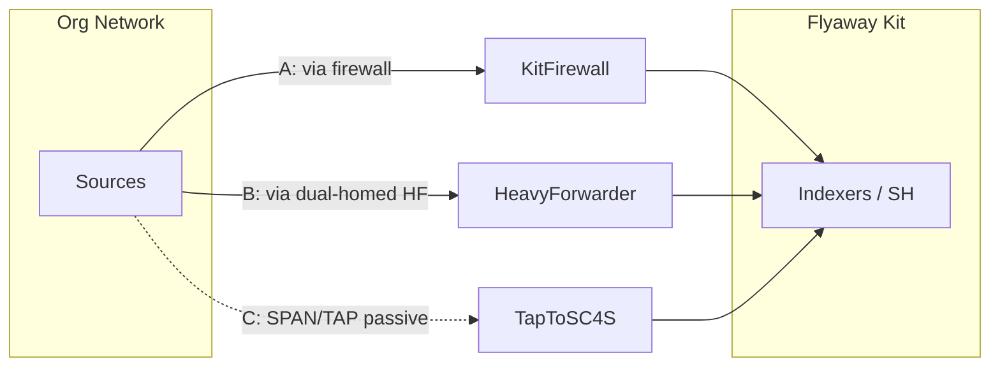

# 13 - Site Integration

How the kit connects to the host organization's network and starts ingesting its data.
The deploying team rarely knows the site in advance, so this document gives the connection
models, a questionnaire to capture what they need to learn, the ingestion-path decision,
and the exact firewall rules the org must open for each path.

Do this only **after** the kit passes internal validation
([08 Phase 6](08-runbook-deploy.md#phase-6--validation)). Stand the kit up on its own LAN
first, then integrate.

## Connection models

Pick one based on the site's trust posture and what the org will allow.



| Model | How | Use when | Trade-off |
|-------|-----|----------|-----------|
| **A - Firewall uplink** | Kit firewall's site interface joins an org VLAN (routed or NAT); sources send to kit ingest through allow rules | Org can route traffic to the kit and will open rules | Cleanest segmentation; needs org firewall changes |
| **B - Dual-homed HF** | One heavy forwarder has a NIC on the org network and a NIC on the kit data VLAN; it is the ONLY touchpoint | Org wants a single, auditable ingress host | HF is a choke point and a trust boundary - harden it ([11](11-security.md)) |
| **C - Passive SPAN/TAP** | A span port / network tap feeds SC4S or an HF; the kit never transmits onto the org net | Strict no-touch / covert / read-only monitoring | Capture only; no UF management, no bidirectional sources |

In all models the kit's **DHCP must not reach the org network**
([03](03-network-design.md#kit-services-dns-dhcp-ntp)) and the kit does not act as a
router for org traffic.

## Site network questionnaire

Fill this in before departure if possible, otherwise on arrival. It is the input to the
ingestion-path decision and the firewall-rule request.

**Addressing and routing**
- Org IP ranges / VLANs in scope? Any overlap with the kit `10.73.0.0/16` plan?
- Will the kit get a routed interface or NAT? Static IP assigned to the kit site NIC?
- Gateway, and is inter-VLAN routing to the sources available?

**Name resolution and time**
- Internal DNS servers? Will the kit be allowed to query them (for host enrichment)?
- Is an org NTP source required/available, or does the kit stay authoritative?

**Egress and proxy**
- Is any internet egress allowed (for connected mode)? Through a proxy? Proxy host/port/auth?
- Firewall change process and approver - how long does a rule take?

**Sources (the core of onboarding)**
- Which data sources exist? (Windows/AD, Linux, network firewalls, proxies, DNS, EDR,
  cloud/SaaS, applications, custom.) See the Flyaway Kit app concept
  ([15](15-flyaway-kit-app-concept.md)) for the structured checklist.
- For each: where does it live, how many hosts, approximate EPS/volume, and how is it
  emitted today (agent, syslog, API)?
- Existing Splunk/UF/forwarder infrastructure on site the kit should receive from or avoid
  conflicting with?
- Any cloud/API sources (need egress) vs. on-prem only?

**Constraints**
- Data classification / handling rules at this site ([11](11-security.md#data-classification))?
- May the kit install UFs on org endpoints, or only receive what the org sends?
- Any assets explicitly out of scope?

## Ingestion-path decision

Map each source type to a collection method. This drives which TA, which DS serverclass,
and which firewall rule.

| Source type | Method | Lands on | TA example |
|-------------|--------|----------|-----------|
| Windows / AD / Sysmon | UF (installed on hosts, managed by kit DS) | Indexers via 9997 | Splunk_TA_windows, Splunk_TA_microsoft_sysmon |
| Linux / Unix | UF | Indexers via 9997 | Splunk_TA_nix |
| Network / security devices (firewall, proxy, DNS appliances) | Syslog -> SC4S | SC4S -> indexers | SC4S source config + CIM |
| EDR / SaaS / cloud (API) | HF modular/API input | HF -> indexers | vendor API TA (needs egress) |
| Applications | HEC | HF/indexers via 8088 | app-specific |
| Collected artifacts / one-off files | Upload / `oneshot` | Indexers | per data |

Decision notes:
- **UF** is preferred for managed endpoints: the kit DS pushes the TA and config
  ([05](05-splunk-deployment.md#deployment-server-forwarder-management)); UFs point their
  `outputs.conf` at the kit indexers.
- **SC4S** is preferred over raw `udp://514` for syslog: it parses, sets sourcetype/index,
  and is Splunk-supported.
- **HF** is needed wherever an input requires code/credentials (API pulls) or routing.
- **HEC** for app/cloud push with scoped tokens.

## Firewall rules per path (what the org must open)

Request the minimum. "Kit" = the kit's site-facing interface(s); ports from
[03](03-network-design.md#splunk-ports-matrix).

| Path | Source -> Destination | Port | Direction |
|------|-----------------------|------|-----------|
| UF -> indexers | Org endpoints -> kit indexers (or HF) | 9997/TCP | Org -> Kit |
| UF mgmt (DS) | Org UFs -> kit DS | 8089/TCP | Org -> Kit |
| Syslog -> SC4S | Devices -> kit SC4S | 514/UDP+TCP, 6514/TCP (TLS) | Org -> Kit |
| HEC | App/cloud senders -> kit HF/indexers | 8088/TCP | Org -> Kit |
| API pull (HF) | Kit HF -> SaaS/cloud API | 443/TCP | Kit -> Internet (via proxy if required) |
| DNS enrichment (optional) | Kit -> org DNS | 53/UDP+TCP | Kit -> Org |

Keep everything else denied. For model B (dual-homed HF), only the HF's org-side address
appears in these rules - that single host is the whole attack/audit surface.

## Validation after integration

- Each onboarded source appears within minutes:
  ```spl
  index=* earliest=-15m | stats count latest(_time) as last_seen by index, sourcetype, host
  ```
- Sourcetypes are correct (not `*-too_small`/`syslog` catch-alls) and CIM-mapped for ES.
- The Flyaway Kit app's per-source check turns green ([15](15-flyaway-kit-app-concept.md)).
- No unexpected flows in the firewall deny log; no kit DHCP leaking to the org net.
