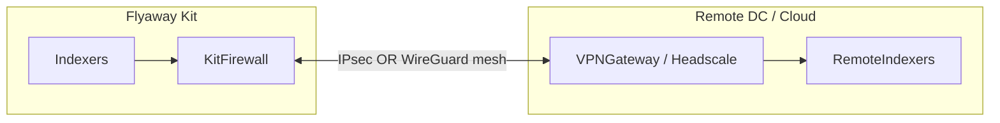

# 14 - Remote Replication and VPN

Optional. When a mission has a usable link, the kit can mirror some or all of its data to
a remote data center or cloud so a copy survives even if the kit is lost, and so analysts
back home can search it. This document covers the VPN transport options, the data
mirroring options with bandwidth trade-offs, and how it ties into the firewall and
security.

This is a connected-mode feature. Air-gapped missions skip it entirely; the primary data
path is always local ([06](06-offline-repo.md#connected-mode-policy)).

## Transport options

The replication traffic rides a VPN from the kit to the remote site, terminated on the kit
firewall ([03](03-network-design.md#firewall-policy), VLAN 40).



### Option 1 - Site-to-site IPsec

- Kit firewall (Cisco Secure Firewall 1210, default, or similar) builds an IPsec tunnel to a remote
  VPN gateway: a corporate DC firewall, or a cloud VPN gateway (AWS VPN, Azure VPN
  Gateway, GCP Cloud VPN).
- Auth: certificate preferred, PSK acceptable if long/unique per mission
  ([11](11-security.md#vpn-key-handling)).
- Firewall ports on the VPN VLAN: IKE UDP/500, NAT-T UDP/4500, ESP.
- **Meraki note:** if both ends are Meraki, Auto VPN simplifies setup - but Meraki needs
  the cloud dashboard, so this is connected-mode only and not for air-gapped/sensitive
  missions ([02](02-hardware-bom.md#firewall-reference)).

### Option 2 - Self-hosted Headscale (WireGuard mesh)

[Headscale](https://github.com/juanfont/headscale) is an open-source, self-hostable
implementation of the Tailscale control server. It gives the kit a private WireGuard mesh
without any third-party SaaS - which fits a sovereignty/air-gap-adjacent posture better
than a commercial coordination service.

- **Control server placement:**
  - At the **remote DC/cloud** - the kit nodes (or the firewall) join the mesh and reach
    the remote indexers over WireGuard. This is the remote-replication use.
  - On the kit **management node** - when you only need to coordinate kit nodes among
    themselves (e.g. an internal overlay); no remote dependency.
- Each node has its own WireGuard keypair; the Headscale server holds node keys + ACLs.
  Use short-lived single-use pre-auth keys to enroll nodes; revoke at teardown
  ([11](11-security.md#vpn-key-handling)).
- Firewall: WireGuard UDP (default 41641) plus the Headscale control/HTTPS port to the
  control server.
- Carry the Headscale binary/image and client packages on the offline media if used
  ([06](06-offline-repo.md)).

| Transport | Pro | Con | Best for |
|-----------|-----|-----|----------|
| IPsec | Standard, firewall-native, works with cloud VPN gateways | Per-peer config; NAT traversal can be fiddly | Fixed kit-to-DC/cloud link |
| Headscale/WireGuard | Self-hosted, simple mesh, no SaaS, fast | You run the control server; newer tooling | Sovereign/multi-node overlays |

## Data mirroring options

How much data crosses the link - choose per available bandwidth. Estimate link demand
before enabling; a saturated uplink will back-pressure indexing.

### A - Forwarded clone (simplest)

Clone the ingest stream: the kit forwarders (or indexers) send a second copy to the remote
indexers via an additional `tcpout` group.

```ini
# outputs.conf on HF/indexers - add a cloned remote group
[tcpout]
defaultGroup = kit_idx

[tcpout:kit_idx]
server = idx01.kit.local:9997, idx02.kit.local:9997, idx03.kit.local:9997

[tcpout:remote_idx]
server = ridx01.remote.example:9997
# cloned output: data goes to BOTH groups
```

```ini
# inputs.conf - send a given input to both groups
[monitor:///var/log/mission]
_TCP_ROUTING = kit_idx, remote_idx
```

- **Bandwidth:** roughly the ingest rate you clone (post-parsing, compressed on the wire).
  Mirroring all of a 100 GB/day stream needs ~10+ Mbps sustained; size to the subset you
  clone.
- **Pro:** simple, near-real-time, no cluster coupling. **Con:** remote is a separate copy,
  not a cluster member; if the link drops, use `useACK` and queue/`maxQueueSize` so the HF
  buffers and backfills rather than dropping.

### B - Multisite indexer cluster (full fidelity, bandwidth-heavy)

Make the remote indexers a second site of the kit's indexer cluster with site-aware
replication/search factors.

- **Pro:** remote site is a true cluster member; search affinity and site failover.
- **Con:** replication (9887) between sites is **bandwidth- and latency-sensitive**; a thin
  or jittery field link is a poor fit. Generally only for missions with a fat, stable link.
- Set `site_replication_factor` / `site_search_factor` so the remote holds the copies you
  want; expect replication traffic on the order of your ingest times the remote copy count.

### C - Scheduled export (low-bandwidth / intermittent)

For thin or intermittent links, don't stream - batch.

- Periodically export the mission indexes' buckets or summary/CSV results and ship them
  over the link when it's up (rsync-over-VPN, or scheduled `outputcsv`/report export).
- **Pro:** tolerant of outages; you control exactly when the link is used. **Con:** not
  real-time; the remote lags by the export interval.
- Pairs well with tactical missions ([12](12-mission-profiles.md#tactical--disconnected-operations)).

| Option | Bandwidth need | Latency | Link tolerance | Remote is... |
|--------|----------------|---------|----------------|--------------|
| A Forwarded clone | Moderate (= cloned ingest) | Near real-time | Buffers via ACK/queue | Separate copy |
| B Multisite cluster | High (ingest x remote copies) | Real-time | Poor (needs stable link) | Cluster member |
| C Scheduled export | Low, bursty | Interval lag | Excellent | Periodic archive |

## Bandwidth planning

```
clone_mbps ~= cloned_GB_per_day * 8 * 1000 / 86400 * compression_factor
            (compression_factor ~0.3-0.5 on the wire)
```
Example: cloning 50 GB/day -> `50*8*1000/86400 ~= 4.6 Mbps` raw, ~1.5-2.3 Mbps compressed
sustained. Multisite adds replication overhead per remote copy. Always leave headroom so
replication never starves local indexing.

## Security and teardown

- VPN keys/certs live on the firewall / Headscale server only, rotated at teardown
  ([11](11-security.md#vpn-key-handling)); revoke Headscale nodes and reset the firewall
  VPN config.
- The remote peer config reveals remote topology - treat as sensitive, wipe at teardown.
- If a remote mirror is the authoritative copy for evidence, confirm it is complete and
  checksum-verified before wiping the local copy
  ([10](10-runbook-teardown.md#phase-2--export--preserve)).

## Validation

- Tunnel up: ping/`reachability` to the remote indexers over the VPN VLAN only.
- Option A: events appear on the remote indexers within seconds:
  ```spl
  index=mission_* | stats count by splunk_server
  ```
  (run on a remote search head) shows remote indexers accumulating.
- Option B: `splunk show cluster-status` reports both sites healthy.
- Option C: last export batch landed and checksums match.
- Link not saturated: local indexing latency stays near zero in the MC
  ([09](09-runbook-operations.md)).
