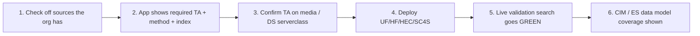

# 15 - Flyaway Kit App (Concept)

> **Concept only - not built.** This document is a design for a Splunk app that would help
> the team onboard an organization's data sources correctly and fast. It defines the
> purpose, workflow, data model, wireframe, and validation logic so the app can be built
> later. No code is delivered here.

## Problem it solves

On arrival the team must figure out, under time pressure, which of the org's data sources
exist, which Splunk add-on (TA) and collection method each needs, where it should land,
and whether it is actually reporting. Today that lives in people's heads and a
[spreadsheet questionnaire](13-site-integration.md#site-network-questionnaire). The app
turns that into a guided, checkable workflow with a live "is it working?" signal.

## Workflow



1. **Select sources.** The analyst checks off the source types the org has (from the
   questionnaire): Windows/AD, Sysmon, Linux, firewalls, proxies, DNS, EDR, cloud/SaaS,
   custom apps, etc.
2. **App maps each source** to its required TA, collection method (UF / HF / HEC / SC4S),
   the DS serverclass that should carry it, and the target index/sourcetype.
3. **Staging check:** the app confirms the TA is present on the offline media / installed
   on the DS, and that the serverclass exists.
4. **Deploy** the collection per [13](13-site-integration.md#ingestion-path-decision).
5. **Live validation:** a per-source saved search turns the row **green** when matching
   data arrives at the right index/sourcetype, **amber** if partial (wrong sourcetype,
   low volume), **red** if nothing.
6. **CIM / ES coverage:** shows which CIM data models the onboarded sources populate, so
   analysts know which ES content will work.

## Data model (KV store)

The app's state lives in a KV store collection so it is editable and searchable. Concept
schema:

```json
// collection: flyaway_sources
{
  "source_key": "windows_security",      // stable id
  "display_name": "Windows Security / AD",
  "category": "endpoint",
  "required_ta": "Splunk_TA_windows",
  "ta_version": "<pinned>",
  "method": "uf",                          // uf | hf | hec | sc4s | upload
  "serverclass": "windows_sources",
  "target_index": "mission_wineventlog",
  "expected_sourcetypes": ["WinEventLog:Security","XmlWinEventLog:Security"],
  "cim_models": ["Authentication","Change"],
  "selected": true,                        // checked off by analyst
  "status": "green",                       // green|amber|red|pending (computed)
  "last_seen": "2026-11-18T14:05:00Z",
  "notes": ""
}
```

A second small collection `flyaway_site` holds the questionnaire answers
([13](13-site-integration.md#site-network-questionnaire)) so the app has the site context
(IP ranges, proxy, firewall process) in one place.

A seed catalog ships with the app: the common source types pre-filled with their TA,
method, and expected sourcetypes, so step 2 is a lookup, not data entry.

## Validation logic (per source)

Each source row's status is computed by a search like:

```spl
| tstats count latest(_time) as last_seen
    where index=$target_index$ sourcetype IN ($expected_sourcetypes$) by sourcetype
| eval status = case(
    count > 0 AND now()-last_seen < 900, "green",
    count > 0, "amber",
    1=1, "red")
```

- **green:** data in the right index/sourcetype within the last 15 min.
- **amber:** data exists but stale, or landing in an unexpected sourcetype.
- **red:** nothing - check the firewall rule, serverclass, and UF phone-home
  ([09](09-runbook-operations.md#common-failures)).

A CIM-coverage view cross-checks `expected_sourcetypes` against the accelerated ES data
models to show what correlation content will populate.

## Wireframe

```
+-----------------------------------------------------------------------+
| Flyaway Kit - Data Source Onboarding            Tier: Medium  [Site v] |
+-----------------------------------------------------------------------+
| [ Filter: all | endpoint | network | cloud | custom ]   [+ Add source]|
+-----+--------------------------+--------+----------+-------------------+
| sel | Source                   | Method | Index    | Status            |
+-----+--------------------------+--------+----------+-------------------+
| [x] | Windows Security / AD    | UF     | wineven..| GREEN  (12s ago)  |
| [x] | Sysmon                   | UF     | sysmon   | AMBER  (wrong st) |
| [x] | Palo Alto firewall       | SC4S   | firewall | RED    (no data)  |
| [ ] | CrowdStrike EDR (API)    | HF     | edr      | --                |
| [x] | Linux syslog             | UF     | nix      | GREEN  (5s ago)   |
+-----+--------------------------+--------+----------+-------------------+
| CIM coverage: Authentication [OK]  Network Traffic [partial]  ...      |
+-----------------------------------------------------------------------+
| Required TAs:  Splunk_TA_windows OK | Splunk_TA_nix OK | PA TA MISSING |
+-----------------------------------------------------------------------+
```

## How it ties into the kit

- **Seed catalog** maps 1:1 to the DS serverclasses in
  [05](05-splunk-deployment.md#deployment-server-forwarder-management) and the ingestion
  paths in [13](13-site-integration.md#ingestion-path-decision).
- **Required-TA check** reads against the offline media manifest
  ([06](06-offline-repo.md#manifestyaml)) so a missing TA is caught before deploy.
- **Status rows** reuse the operational validation searches
  ([09](09-runbook-operations.md#key-health-searches)).

## If/when it is built (out of scope now)

- Package as a standard Splunk app (KV store collections + `transforms.conf` lookups + a
  dashboard-studio or SimpleXML UI + the saved searches above).
- Install on the ES SH (or ad-hoc SH).
- Keep the seed catalog in version control alongside this repo so new source mappings are
  reviewed and travel on the offline media.

> This remains a concept. Building it is explicitly out of scope for this documentation
> set ([README](../README.md#out-of-scope)).
